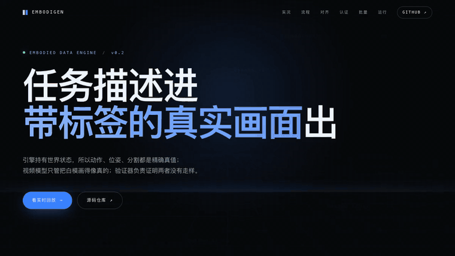
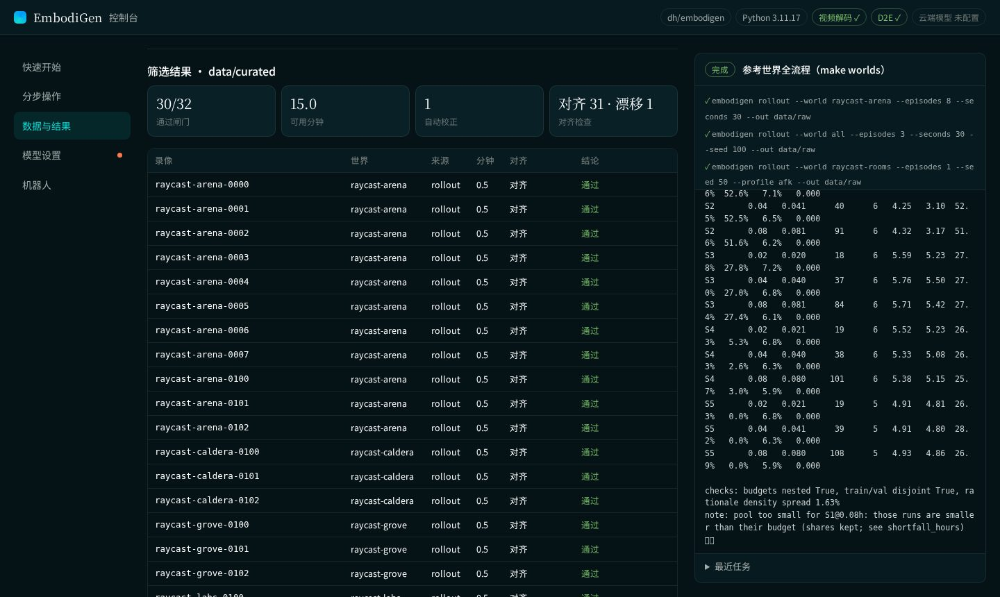
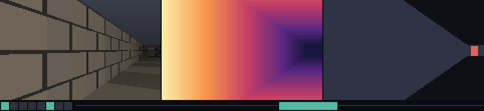
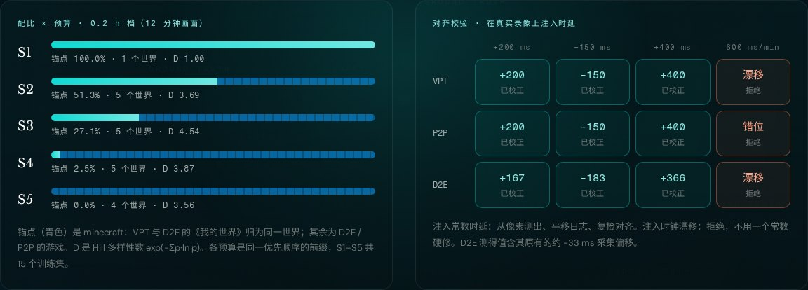
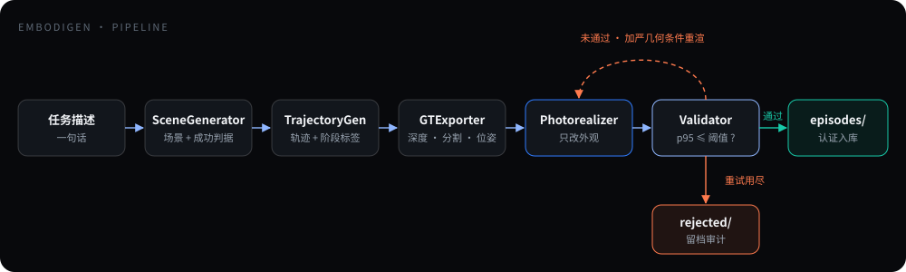
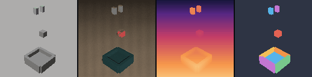
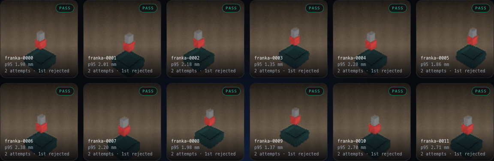

<p align="center">
  <a href="https://wellkilo.github.io/embodigen/">
    
  </a>
  <br />
  <sub>▶ <a href="https://wellkilo.github.io/embodigen/assets/showcase.mp4">观看 69 秒完整演示视频（MP4）</a> · 页面上的每个数字和每一帧都来自管线的真实运行</sub>
</p>

<h1 align="center">EmbodiGen</h1>

<p align="center">
  <b>给具身智能体造带精确动作标签的训练数据：机器人 episode，以及虚拟世界里的键鼠游戏数据。</b><br />
  <sub>引擎负责真值 · 闸门把坏样本挡在数据集外 · 账本说清楚留下了什么、丢掉了什么、为什么</sub>
</p>

<p align="center">
  <a href="https://github.com/wellkilo/embodigen/actions/workflows/ci.yml"></a>
  
  
  
  
  <a href="https://wellkilo.github.io/embodigen/"></a>
</p>

<p align="center">
  <a href="https://wellkilo.github.io/embodigen/"><b>在线展示</b></a> ·
  <a href="#快速开始">快速开始</a> ·
  <a href="#网页控制台">网页控制台</a> ·
  <a href="#虚拟世界管线gamescaling">虚拟世界管线</a> ·
  <a href="#机器人管线它是什么">机器人管线</a> ·
  <a href="#输出长什么样">数据格式</a> ·
  <a href="#替换后端">替换后端</a>
</p>

---

## 快速开始

```bash
git clone https://github.com/wellkilo/embodigen && cd embodigen
python3 -m venv .venv && . .venv/bin/activate
pip install -e .

# 一条
embodigen gen --task "把红色方块放进盒子" --out out --resolution 96
embodigen validate --episode out/episodes/franka-0000

# 一批（8 条，4 进程）
embodigen gen --task "把红色方块放进盒子" --out out --resolution 64 --episodes 8 --workers 4
embodigen index --out out

# 看一眼
embodigen preview --episode out/episodes/franka-0000
```

虚拟世界管线（GameScaling 数据后台，详见[下一节](#虚拟世界管线gamescaling)）：

```bash
embodigen rollout --world all --episodes 3 --seconds 30 --out data/raw     # 在参考世界里录制
embodigen curate  --raw data/raw --out data/curated                         # 对齐 · 规范化 · 闸门
embodigen build   --curated data/curated --study configs/studies/reference.toml --out data/mixes

make samples   # 真实公开数据：下载 VPT / D2E / Open-P2P 各 3 条 → ingest → curate → build
embodigen ledger  data/mixes/reference                                      # S1–S5 × 预算 的账本
```

不想记命令？`embodigen ui` 打开[网页控制台](#网页控制台)，同样的步骤都能点按钮完成。

零第三方依赖，Python ≥ 3.11，不需要 GPU（ViZDoom 后端是可选的 `[env]` extra）。单条 96 px 约 3 秒，8 条 64 px 用 4 进程约 3.5 秒（Apple Silicon 实测）。

<details>
<summary><b>真实输出</b></summary>

```
$ embodigen gen --task "把红色方块放进盒子" --out out --resolution 96
episode      franka-0000
instruction  把红色方块放进盒子
robot        arm / franka
frames       28 @ 8 fps, 96x96
attempts     2 (seeds [0, 1])
fidelity     p95     2.27 mm  max     2.28 mm  threshold 12 mm  -> PASS
written      out/episodes/franka-0000
```

`attempts 2`：第一次渲染被默认注入 25 mm 几何漂移（`--drift`，用来演示闭环），验证器拒绝，第二次加严几何条件后通过。用 `--drift 0` 可关闭注入。

</details>

## 网页控制台

```bash
embodigen ui            # 打印 http://127.0.0.1:8765/#token=…，用浏览器打开这个完整链接
```

<p align="center">
  
</p>

把命令行的每一步做成表单：

- **快速开始**：「参考世界」「公开样例」各一个按钮，等价于 `make worlds` / `make samples`，可勾选下载视频、填 Hugging Face 镜像、选理由标注器。
- **分步操作**：下载、录制、导入、筛选、构建，表单下方实时显示将要执行的 `embodigen …` 命令，照抄到终端效果相同。
- **数据与结果**：扫描 `data/`、`out/`，点开就能看筛选账本（每条录像的对齐与拒绝理由）、训练集网格（S1–S5 × 预算、Hill D、锚点占比、缺口），原始录像可一键生成 GIF 预览。
- **模型设置**：选服务商、填模型名和 API key。key 只写进 `~/.config/embodigen/llm.toml`（权限 600），不会回显到页面，也不进日志和命令行；没配好时带 `llm` 的任务直接拒绝，不会开跑。
- **任务面板**：一次只跑一个任务，显示每一步命令和实时日志。「停止」相当于按 Ctrl+C；下载中途停止会保留 `.part`，下次断点续传。

只监听 127.0.0.1，所有接口都要启动时打印的令牌，别的网页和本机其他用户都调不动它。程序跑在远程服务器上时，在自己电脑上执行 `ssh -L 8765:127.0.0.1:8765 <服务器>`，再在本地浏览器打开那个链接。控制台本身也只用标准库，零依赖。

## 虚拟世界管线（GameScaling）

服务于 [GameScaling](https://gamescaling.github.io/)（arXiv 2610.28698）这类工作：把游戏当作具身智能体的仿真环境，把"玩家看到了什么、按了什么"做成可以直接做 scaling 研究的训练数据。它和机器人管线共用同一套做法：纯 dataclass 数据契约、按协议替换的后端、不达标进不了数据集的闸门、可审计的账本。

<p align="center">
  <br />
  <sub>一条录像的 5 Hz 回合：画面 · 引擎深度 · 实例标签；下方亮起的是该回合动作包里按住的键（W A S D 空格 Shift 左键 右键），蓝条是鼠标 dx（<code>embodigen preview --recording</code> 的真实输出）</sub>
</p>

### 三个阶段

```
rollout / ingest  →  data/raw/<recording>/        引擎录制，或把数据集转换成统一的原始布局
curate            →  data/curated/                对齐校验 · 动作规范化 · 闸门，失败的进 rejected.jsonl
build             →  data/mixes/<study>/          划分 · 窗口 · 配比 × 预算 · 稀疏推理 · 分片 + manifest
```

每个阶段只读上一个阶段的目录，可以分机器跑；每个阶段都写 `ledger.json`。

### 每一步对应论文里的哪条要求

| 阶段 | 做什么 | 依据（论文） |
|---|---|---|
| 数据源 | `vpt`（Minecraft 承包商 jsonl）、`d2e`（OWAMcap：MCAP + mkv）、`p2p`（Open-P2P 的 protobuf 标注）三个适配器；`raycast`（标准库参考世界）与 `vizdoom`（真 Doom）两个可录制引擎 | 训练数据来自 VPT / D2E / OpenP2P；DOOM 是 in-corpus 世界 |
| 动作规范化 | 5 Hz 观测；每个 200 ms 动作包 = Δx、Δy ∈ [-1000, 1000]，Δz ∈ [-5, 5]，6 个 33 ms 按键槽，每槽 0–4 个键 | 统一键鼠动作格式 |
| 对齐校验 | 只读像素和事件日志，分段（开头 / 中间 / 结尾）测输入日志相对视频的时延；各段一致的常数时延校正后复检，时钟漂移或无法确认的直接拒绝 | 本项目新增（论文未描述） |
| 采集闸门 | 非游戏前台输入 ≥ 5%、≥ 50% 鼠标事件为光标回中、< 60 事件/分钟、< 3 次键/点击每分钟、空闲窗口 > 60% → 拒绝；OOD 标题需 ≥ 60% 录像通过 | OOD 录像池的拒绝规则 |
| 窗口 | 20 回合、步长 10；空闲为主的窗口按哈希降采样；每个源流按整条录像封顶 | 20-turn 窗口 / 10 步长 / idle 降采样 / per-stream cap |
| 划分 | 按**录像**划分，三级验证：anchor（论文里是 Minecraft）、in-corpus（每个游戏同样多的片段 + 同规模锚点子集）、OOD（按标题 / 别名 / 系列 / 模拟器去重） | 三级 validation loss |
| 配比 | S1–S5 锚点占比 100 / 51.4 / 27.1 / 2.8 / 0%；非锚点按池中比例交错；Hill 数 D、逆 Simpson、最大占比 | 混合配比与多样性定义 |
| 预算 | 同一优先级顺序的前缀，所以 50h ⊂ 100h ⊂ … ⊂ 1600h；数据不够时缩小规模、保持配比、记下缺口 | 6 档预算、控制变量 |
| 稀疏推理 | 每个回合按哈希决定是否带 rationale（默认 5.7%），所有配比密度一致；rationale 只解释、不改动作；按（标注器, prompt 版本, 录像, 回合）缓存 | 5.4–6.0% 的 assistant 回合带推理 |
| 序列化 | `<think>…</think><\|action_start\|> Δx ; Δy ; Δz ; k1 ; … ; k6 <\|action_end\|>`，messages + images 格式，只对 assistant 计 loss；按窗口哈希分片，manifest 记录每个分片的 sha256 | 训练模板 |

`configs/studies/gamescaling.toml` 按论文写好了真实网格（5 配比 × 6 档预算、160 片段/世界、30 个 in-corpus 游戏、15% VL anchor、seed 3407）。论文没公开的数值（空闲降采样率、源流上限）在文件里标了 `unpublished`，跑真数据前要定下来。

### 对齐校验在测什么

转视角时画面会整体水平平移。校验器从相邻两帧的列亮度剖面估计这个平移，再和事件日志里同一时段的鼠标 dx 做互相关，扫描 ±600 ms 的时延。两个序列都先差分（预白化）再取秩：鼠标运动是平滑的，不差分的话相关峰会很宽、能偏好几帧。

录像够长时，在开头、中间、结尾各测一段。各段时延一致，说明是采集时的常数偏移，可以平移整份日志修正；各段不一致，说明是时钟漂移，用一个常数修不好，直接拒绝。只有部分段测得出结果时，也不做修正。

两条规则来自真实数据：

- **容差有毫秒下限（34 ms）**：一个动作包最细的时间单位是 33 ms 的按键槽，比这小的时延不改变任何标签。60 fps 采集时，一帧容差只有 16.7 ms，测量噪声就可能触发校正，所以加了这个下限。
- **漂移追踪**：一段有镜头运动、却和鼠标不相关，而相邻一段测得出时，校验器从测得出的那段出发，分 4 步走向它，每一步都以上一步的时延为中心重新搜索。这样能跟住超出 ±600 ms 窗口的漂移。单纯放宽窗口不行：在真实录像上，±3000 ms 的窗口会让 Brotato 这类干净录像出现 0.25 的伪峰，被误判为漂移。

真实运行结果（参考世界，30 Hz 录制）：

| 条件 | 测得时延 | 判定 |
|---|---|---|
| 正常录制 | 0 ms | 通过 |
| 输入日志注入 +300 ms 时延 | +300 ms | 校正后复检对齐，通过，`realigned_ms` 记入账本 |
| 注入 −200 ms（迷宫布局，64×40） | −200 ms | 校正后通过 |
| ViZDoom 注入 +250 ms，`--no-realign` | +229 ms（35 Hz 下的 8 帧） | 拒绝 |
| 输入日志按 600 ms/分钟 漂移（60 s 录像） | 三段分别 0 / 267 / 500 ms | `clock_drift`，拒绝 |

帧存在视频里的录像（VPT、D2E、P2P）通过 `video` 后端解码：`pip install -e '.[video]'` 安装 PyAV，校验器每段 seek 一次，向前解码，取灰度缩略图。没装解码器或视频不在本地时记为 `skipped`，不会因此被拒。

真实公开录像上的结果（`make samples VIDEO=--video`；"注入"指把真实录像的输入日志整体平移或按比例拉伸后重新校验）：

| 录像 | 自然状态 | 注入 +200 / −150 / +400 ms | 注入 600 ms/分钟 漂移 |
|---|---|---|---|
| VPT（20 fps） | 三段 0 ms，相关 0.31–0.77，对齐 | 测得 +200 / −150 / +400，校正后对齐 | `drift`，拒绝 |
| Open-P2P（20 fps） | 三段 0 ms，对齐 | 测得 +200 / −150 / +400，校正后对齐 | `misaligned`，拒绝 |
| D2E Minecraft（60 fps） | 三段 −50 / −17 / −33 ms，一致的约 −33 ms 采集偏移，校正后三段 −17 / 0 / +17 | 测得 +167 / −183 / +366（即注入值加上原有的 −33），校正后对齐 | 追踪到 −17 → −600 ms，`drift`，拒绝 |
| D2E CS2（60 fps） | 开头在菜单里测不出，中段 0 ms，对齐 | 中段测得注入值，但开头测不出，不做校正，拒绝 | 三段都测不出，`inconclusive`，**放行** |
| D2E Brotato（俯视 2D） | 鼠标只瞄准、不转镜头，`inconclusive`，放行 | — | — |

最后两行是这项校验的边界：一条录像如果没有任何一段能和鼠标对上（俯视游戏，或者漂移大到每一段内部都被拉伸），它就无法验证，结果记为 `inconclusive`，照常放行。curate 账本会单独统计这类录像（`alignment: aligned 8, inconclusive 1`），由使用者决定是否要求它们必须通过验证。

### 账本长什么样

`make worlds` 的真实输出（7 个参考世界，32 条录像；其中一条故意挂机，一条注入 300 ms 时延，一条注入 600 ms/分钟 的时钟漂移）：

```
  raycast-lava-0070-player-lag300    realigned +300 ms        PASS
  raycast-maze-0080-player-drift600  drift (+267 ms)          REJECT  clock_drift: input/video lag moves across the recording ([0.0, 266.7, 500.0] ms)
  raycast-rooms-0050-afk             aligned                  REJECT  idle_windows: 100% of windows idle (limit 60%)
certified    30/32 (94% yield), 15.0 min, 1 realigned -> data/curated

pool  238 windows, 8.5 min of footage (budgets count footage), D=5.37 over 6 worlds
val   anchor       8 clips  1 worlds  1 recordings
val   in_corpus   48 clips  6 worlds  5 recordings
val   ood          8 clips  1 worlds  3 recordings

mix  budget h footage samples worlds Hill D 1/Simp    max anchor  think short h
S1       0.08   0.050      84      1   1.00   1.00 100.0% 100.0%   5.6%   0.030
S2       0.08   0.081      91      6   4.32   3.17  51.6%  51.6%   6.2%   0.000
S3       0.08   0.081      84      6   5.71   5.42  27.4%  27.4%   6.1%   0.000
S4       0.08   0.080     101      6   5.38   5.15  25.7%   3.0%   5.9%   0.000
S5       0.08   0.080     108      5   4.93   4.86  26.9%   0.0%   5.9%   0.000

checks: budgets nested True, train/val disjoint True, rationale density spread 1.63%
note: pool too small for S1@0.08h: those runs are smaller than their budget (shares kept; see shortfall_hours)
```

（只截了最大一档预算；完整网格在 `data/mixes/reference/ledger.json`。）S1 在这一档锚点数据不够，账本如实写出缺口，而不是从别的世界补。

### 真实公开数据

<p align="center">
  
</p>

三个适配器都按公开数据的真实文件写成并验证过：字段名、编码和怪癖都取自下载下来的样本，没有靠猜。`make samples` 会下载这些样本（只取动作日志，约 88 MB；视频用 `--video` 另取），全程跑一遍。下载显示进度，中断后再跑会断点续传；Hugging Face 访问慢时加镜像：`embodigen fetch --video --hf-endpoint https://hf-mirror.com`（或设置 `HF_ENDPOINT`）。

| 数据源 | 原始格式 | 适配器处理了什么 |
|---|---|---|
| VPT（OpenAI 承包商数据 6.x） | 每帧一行 jsonl，20 fps | 首帧"卡住"的攻击键；`yaw / pitch / xpos / ypos / zpos` 存为位姿状态；按目录名识别 test/val 划分 |
| D2E-480p（OWAMcap） | MCAP（zstd 分块、JSON 消息）+ 60 fps mkv | 标准库解析 MCAP；鼠标位移取 `mouse/raw` 的 HID 原始计数，按 10 ms 合箱，正好整除 200 ms 网格；丢弃 Windows 按键自动重复（CS2 一条录像里 1864 次）；前台时间最长的窗口标题视为游戏，切到别的窗口记为焦点变化，交给闸门的非游戏输入规则；`_split_NN` 分段共享同一个 `session` |
| Open-P2P | `annotation.proto`（protobuf），20 fps | 标准库按字段号解码；负的 int32 鼠标位移按补码解出；P2P 推理服务器代打的帧（`system_action`）和未知帧会把录像切开，只保留人类连续段，各段共享 `session`；帧级文字指令存进观测状态 |

`session` 是这次新加的划分单位：同一局切出来的几段永远落在划分的同一侧，`assert_disjoint` 会同时检查录像和 session。

`make samples` 的真实输出（9 条录像、6 个世界、72.5 分钟）：

```
world                          source  recs certified   pass  minutes   clip  rejections
brotato                           d2e     1         1   100%      4.8   0.0%  -
call-of-duty-mobile               p2p     1         1   100%      2.0   0.3%  -
counter-strike-2                  d2e     1         1   100%     10.4   0.4%  -
grand-theft-auto-san-andreas      p2p     1         1   100%     15.7   0.2%  -
minecraft                     d2e,vpt     4         4   100%     21.3   0.2%  -
roblox-a-dusty-trip               p2p     1         1   100%     18.3   0.5%  -

pool  1843 windows, 63.2 min of footage (budgets count footage), D=4.54 over 5 worlds
mix  budget h footage samples worlds Hill D 1/Simp    max anchor  think short h
S1        0.2   0.201     237      1   1.00   1.00 100.0% 100.0%   5.3%   0.000
S2        0.2   0.201     193      5   3.69   2.98  51.3%  51.3%   5.2%   0.000
S3        0.2   0.200     192      5   4.54   4.28  27.6%  27.1%   5.1%   0.000
S4        0.2   0.200     196      5   3.87   3.46  36.7%   2.5%   5.6%   0.000
S5        0.2   0.200     197      4   3.56   3.30  38.1%   0.0%   5.6%   0.000
checks: budgets nested True, train/val disjoint True, rationale density spread 0.97%
```

D2E 的《我的世界》和 VPT 被识别为同一个世界（`Minecraft_1.21.8` → `minecraft`），一起作为锚点；Call of Duty: Mobile 作为 OOD 留出。`clip` 列是鼠标位移撞到 ±1000 上限的动作包比例。CS2 在 `mouse_scale = 1.0` 时测得 3.2%，所以 `configs/worlds/catalog-d2e.toml` 给它设了 0.5（降到 0.4%）。其他游戏都在 0.5% 以内。

只取动作日志时，对齐校验记为 `skipped`；加上 `VIDEO=--video` 并装好 `[video]` 后，9 条里有 8 条测得对齐，1 条（Brotato）无法验证。D2E 的游戏目录（29 款）和 P2P 已知标题放在 `configs/worlds/catalog-*.toml`，一个文件写多个 `[[world]]`。没登记的标题会用 slug 作为标签照常进入数据池。

### 用云端大模型写 rationale

`annotator = "llm"` 通过 **OpenAI 兼容的 Chat Completions 接口**调用云端模型。客户端只用标准库 `urllib` 实现，不需要额外装 SDK，也不需要在本地部署模型。内置以下服务商的接口地址：

| provider | 接口地址 | 密钥环境变量 |
|---|---|---|
| `dashscope`（通义千问） | `https://dashscope.aliyuncs.com/compatible-mode/v1` | `DASHSCOPE_API_KEY` |
| `deepseek` | `https://api.deepseek.com/v1` | `DEEPSEEK_API_KEY` |
| `moonshot` | `https://api.moonshot.cn/v1` | `MOONSHOT_API_KEY` |
| `zhipu` | `https://open.bigmodel.cn/api/paas/v4` | `ZHIPUAI_API_KEY` |
| `ark`（火山方舟） | `https://ark.cn-beijing.volces.com/api/v3` | `ARK_API_KEY` |
| `openai` | `https://api.openai.com/v1` | `OPENAI_API_KEY` |
| `custom` | 自己填 `base_url` | `EMBODIGEN_LLM_API_KEY` |

**用之前必须先提供 API key**，没有 key 什么都不会运行：

```bash
embodigen llm setup            # 依次问服务商、模型名、API key（输入不回显），写入 ~/.config/embodigen/llm.toml，权限 600
embodigen llm check --ping     # 显示最终生效的配置（key 只显示来源），发一个很小的请求确认能连通
embodigen build --curated data/samples-curated --study configs/studies/public-samples.toml --annotator llm
```

- **缺配置时立刻停下**：`build --annotator llm` 一开始就检查服务商、模型名和 key，缺了就停，并提示去跑 `embodigen llm setup`。这时还没切分、也没写任何文件。
- **配置优先级**：环境变量 > `~/.config/embodigen/llm.toml` > study 里的 `[reasoning.llm]`。
- **key 只放在本地**：key 不会写进 study 文件，study 里出现 key 会直接被拒，因为 study 文件会提交进仓库。key 也不会出现在账本、缓存或输出里。
- **模型看到什么**：发给模型的是玩家当时看到的那一帧（PNG 直接用；视频里的帧经 `[video]` 解码，缩到 448 宽），加上这 200 ms 里实际的按键和鼠标输入，以及前 1 秒的输入概况。模型据此写一两句第一人称的推理，不超过 50 词。
- **动作标签不变**：rationale 只解释动作，不改动作。动作标签始终只来自输入日志。
- **纯文本模型**：用不支持图片的模型时，设 `images = false`，就只发文字。
- **并发和费用**：build 先找出所有配比和预算会用到的、被选中的回合，用 `workers` 个并发请求填满缓存，之后写分片时只读缓存。遇到 429、5xx 和超时会按退避策略重试；4xx 直接报错，不会反复浪费请求。中途失败时，已经拿到的结果都留在缓存里，重跑只补缺的部分；再次 build 不会发任何请求。
- **账本记录**：`annotator_config` 记下服务商、模型、prompt 版本，以及请求数和 token 用量（不含 key）。缓存按"服务商 + 模型 + prompt 版本"分开，换模型不会和旧结果混在一起。

目前还没有接真实服务商跑过：这台机器上没有任何服务商的 key。测试用的是进程内的假接口，覆盖了请求格式、图片、重试、失败后续跑、"无 key 不运行"，以及 key 不外泄。拿到 key 之后，先跑 `llm check --ping`，再抽一批 rationale 人工检查质量。

### 产物

```
data/
├── raw/<recording_id>/          # 录制或转换得到的统一原始布局
│   ├── recording.json            # 世界 · 来源 · 源流 · 帧率 · 鼠标缩放 · 是否引擎真值
│   ├── events.jsonl              # 按键/按钮按下抬起 · 鼠标计数 · 滚轮 · 前台应用切换
│   ├── obs.jsonl                 # 每帧：时间 · 帧路径（或 video.mp4#t=…）· 5 Hz 网格上的状态
│   ├── frames/ depth/ labels/    # PNG 画面；引擎导出的 float32 深度和 uint16 实例标签
├── curated/
│   ├── recordings.jsonl          # 每条录像的指标、对齐结果、判定与理由
│   ├── rejected.jsonl            # 被拒的录像，没有 turns 文件
│   ├── turns/<id>.jsonl          # 规范化后的 5 Hz 回合
│   └── ledger.json               # 按世界统计的通过率（OOD 标题的 60% 门槛用它）
└── mixes/<study>/
    ├── S1 … S5/<budget>h/        # train-*.jsonl 分片 · manifest.json · windows.txt
    ├── val/                      # anchor / in_corpus / ood，所有配比共用
    ├── cache/                    # rationale 缓存
    └── ledger.json               # 整个网格的账本与检查结果
```

一条训练样本（S3 / 0.08h 的真实产物，截断）：

```json
{
  "id": "raycast-rooms-0101:000010",
  "world": "raycast-rooms",
  "recording": "raycast-rooms-0101",
  "messages": [
    {"role": "user", "content": "<image>"},
    {"role": "assistant", "content": "<think>\nThere is a pickup to my left, about 1.0 m away, so I keep it in view: strafing right, swinging the view left.\n</think>\n<|action_start|> -66 ; 1 ; 0 ; d,2 ; d,2 ; d ; d ; d ; a <|action_end|>"},
    {"role": "user", "content": "<image>"},
    {"role": "assistant", "content": "<think>\n</think>\n<|action_start|> 125 ; 1 ; 0 ; a ; a ; a ; a ; a ; a,e <|action_end|>"}
  ],
  "images": ["raycast-rooms-0101/frames/000168.png", "raycast-rooms-0101/frames/000174.png"]
}
```

（从一个 20 回合样本里截出两个回合。第一个回合恰好被选中带 rationale，第二个是空的 `<think>`。）

图片路径相对于 manifest 里的 `media_root`。

### 接新的数据源、世界或标注器

- **新世界**：在 `configs/worlds/` 放一个 `<label>.toml`（类别、视角、别名、系列；能跑的世界再写 `engine` 和 `engine_args`）。`embodigen worlds` 会列出来。
- **新数据集**：实现 `discover(root)` 和 `convert(path, out_root, registry)`，写出统一的原始布局，然后在 `BACKENDS["source"]` 注册。可以参照 `gameplay/sources/` 下的 `vpt.py`（逐帧 jsonl）、`d2e.py`（事件流）、`p2p.py`（逐帧 protobuf，一个文件切成多条录像）。
- **新引擎**：实现 `reset / step / observe / done / close`，`observe` 返回的状态里带 `visible` 列表，脚本玩家就能直接驱动它。
- **别的推理标注后端**：实现 `rationale(turn, context, world, media)`，设置 `name` 和 `prompt_version`，注册到 `BACKENDS["annotate"]`。缓存和"每个回合只标一次"的规则自动生效；有 `workers` 属性的后端会先并发填缓存（参照 `gameplay/llm.py`）。

## 机器人管线：它是什么

机器人策略训练缺的不是视频，是**带准确动作标签**的视频。纯仿真的标签准，但画面是 CG；生成模型的画面真，但动作只能靠估计。

EmbodiGen 把这两件事拆开：

| | |
|---|---|
| **输入** | 一句任务，例如「把红色方块放进盒子」；外加机器人本体配置（URDF + 动作空间） |
| **输出** | 自包含的 episode 目录：照片级帧 + 动作序列 + 阶段标签 + 精确的深度 / 分割 / 位姿 + 忠实度报告 |
| **保证** | 标签由引擎从几何算出，不是从视频里估的；渲染器只改外观；验证器证明几何没有被带偏，**不达标的样本进不了数据集** |

<p align="center">
  
</p>

六个阶段都在 `src/embodigen/modules/` 下，各自一个接口。当前的场景、引擎和渲染器是参考实现；换成 ManiSkill3 或 Wan 只需实现对应方法并注册。产物按 LeRobot 的形状组织，可以直接接进 OpenVLA、π0、Diffusion Policy 这类训练流程：视频帧喂视觉塔，`action` 喂动作头，`phase` 做子任务监督，`fidelity` 用来筛选或加权样本。

## 输出长什么样

<p align="center">
  <br />
  <sub>同一条 episode 的四个通道：白模 · 照片级 · 深度 · 实例分割（<code>embodigen preview</code> 的真实输出）</sub>
</p>

```
out/
├── index.json                  # 数据集账本：每条的 p95 / 重试次数 / 判定 + 良率汇总
├── episodes/                   # 只放认证通过的样本
│   └── franka-0000/
│       ├── meta/
│       │   ├── info.json        # 特征描述（LeRobot 形状）
│       │   ├── provenance.json  # 引擎 · 渲染器 · 验证器 · 配置哈希 · 种子 · 重试
│       │   ├── fidelity.json    # 逐帧误差与判定
│       │   └── scene.json       # 相机 · 物体 · 成功判据
│       ├── data/chunk-000/
│       │   └── episode_000000.jsonl   # 一帧一行，共 28 行
│       └── frames/
│           ├── photoreal/  002.png / .rgb   # 渲染后的真实感帧
│           ├── white/      002.png / .rgb   # 引擎白模
│           ├── depth/      002.f32          # float32，平面 Z（米）
│           └── seg/        002.u16          # 实例分割 id
└── rejected/                   # 重试用尽仍未通过的样本，结构相同，留档审计
```

`episode_000000.jsonl` 里的一行（真实产物，未做修饰）：

```json
{
  "frame_index": 2,
  "timestamp": 0.375,
  "language_instruction": "把红色方块放进盒子",
  "phase": "pre_grasp",
  "frames": {
    "photoreal": "frames/photoreal/002.png",
    "white_model": "frames/white/002.png",
    "depth": "frames/depth/002.f32",
    "segmentation": "frames/seg/002.u16"
  },
  "action": [-0.494248, 1.008909, -0.8, 0.0, 0.0, 0.0, 0.04],
  "observation": {
    "eef_position": [-0.041781, 0.126114, 0.14],
    "gripper_width": 0.04,
    "object_positions": { "cube": [-0.041781, 0.126114, 0.02] }
  },
  "fidelity": { "drift_px": 0.0 }
}
```

| 字段 | 含义 |
|---|---|
| `action` | 7 维控制量：三轴平移速度（m/s）、三轴角速度（当前版本为 0）、夹爪开度（m） |
| `phase` | 规划器给出的子任务标签：`pre_grasp` → `grasp` → `close` → `lift` → `transport` → `place` → `release` → `retreat` |
| `observation` | 引擎真值：末端位置、夹爪开度、物体中心 |
| `frames` | 同一帧的四个通道，路径相对于 episode 根目录 |
| `fidelity.drift_px` | 该帧被注入的几何漂移；认证过的样本为 0 |

`meta/fidelity.json` 是这条样本的判定（另有 `per_frame_mm`，28 个逐帧误差）：

| 字段 | 值 |
|---|---|
| `passed` | `true` |
| `threshold_mm` | `12.0` |
| `p95_error_mm` | `2.265503286773332` |
| `max_error_mm` | `2.278999569164691` |
| `mean_error_mm` | `1.0253204858279945` |
| `validator` | `keypoint-appearance-v0` |
| `notes` | `object mean 3.3 mm …` / `eef mean 1.0 mm, gate on eef p95` |

读一条样本，不需要 import 本项目：

```python
import json
from pathlib import Path

root = Path("out/episodes/franka-0000")
rows = [json.loads(l) for l in (root / "data/chunk-000/episode_000000.jsonl").open()]

row = rows[10]
action = row["action"]                       # 7 维，直接喂策略
phase = row["phase"]                         # 子任务标签
image = root / row["frames"]["photoreal"]    # 照片级帧
depth = root / row["frames"]["depth"]        # float32 深度，96×96
```

## 验证器在测什么

<p align="center">
  
</p>

它只读渲染出来的像素和相机内参：把夹爪从画面里找回来，与引擎真值投到同一相机上比重投影误差，换算成毫米。

| 条件（96 px） | p95 | 判定 |
|---|---|---|
| 正常渲染 | 2.27 mm | 通过（阈值 12 mm） |
| 注入 25 mm 几何漂移，不重试 | 28.10 mm | 拒绝 → `out/rejected/` |

重试不是再渲一次碰运气：每一轮都加严几何、深度、分割的条件权重，种子与权重写进 `meta/provenance.json`，事后可审计。

## 批量与账本

<p align="center">
  
</p>

`--episodes N` 在种子 `seed … seed+N-1` 上生成 N 条，`--workers K` 用多进程并行；每条独立验证，认证通过的进 `out/episodes/`，没通过的进 `out/rejected/`。所有结果合并进 `out/index.json`：

```bash
embodigen gen --task "把红色方块放进盒子" --out out --resolution 64 --episodes 8 --workers 4
embodigen index --out out      # 打印每条的 p95、重试次数、判定，以及良率
```

多次运行会按 episode id 合并进同一本账，不会互相覆盖。

## 命令一览

| 命令 | 作用 |
|---|---|
| `embodigen gen --task "..." [--robot franka\|mobile\|humanoid]` | 跑完整链路，生成一条 episode |
| `embodigen gen ... --episodes N --workers K` | 在种子 `seed … seed+N-1` 上并行生成一批 |
| `embodigen validate --episode <dir>` | 只凭目录重算忠实度 |
| `embodigen preview --episode <dir> [--channels white,photoreal,depth,seg]` | 写出四通道 GIF |
| `embodigen index --out <dir>` | 打印数据集账本与良率 |
| `embodigen backends` | 列出已注册的后端与机器人本体 |
| `embodigen worlds` | 列出已注册的虚拟世界 |
| `embodigen rollout --world <a,b\|all> -n N [--profile player\|afk\|distracted] [--lag-ms X] [--drift-ms-per-min X]` | 让脚本玩家在世界里录制 N 条（后几个参数故意制造坏样本，用来验证闸门） |
| `embodigen fetch [--video] [--hf-endpoint <镜像>]` | 下载真实公开样例（带进度、可断点续传） |
| `embodigen ingest --source vpt\|d2e\|p2p --input <dir> [-j K]` | 把数据集录像转换成统一原始布局 |
| `embodigen curate --raw <dir> --out <dir> [--no-realign]` | 对齐校验、动作规范化、闸门 |
| `embodigen build --curated <dir> --study <toml>` | 划分、配比 × 预算、稀疏推理、分片 |
| `embodigen ledger <dir>` | 打印 curate 或 build 的账本 |
| `embodigen llm setup` / `llm check --ping` | 填入并检查云端模型的服务商、模型名和 API key（`annotator = "llm"` 必须先做这一步） |
| `embodigen ui [--port 8765]` | 本地网页控制台：上面这些步骤都能在浏览器里点按钮完成，带实时日志和停止按钮 |
| `embodigen preview --recording <dir> [--start 秒] [--max-frames N]` | 把一条录像画成带键鼠条的 GIF；数据集录像从视频里解码（需要 `[video]`），按原始采集比例还原画面 |

常用参数：`--resolution`（默认 64）、`--fps`（8）、`--threshold`（12 mm）、`--attempts`（3）、`--drift`（首轮注入漂移，默认 25 mm，0 关闭）、`--seed`。

## 替换后端

每个阶段只是一个满足 `src/embodigen/modules/base.py` 协议的对象（按形状匹配，不需要继承）。接一个新渲染器：

```python
# my_pkg/wan.py
class WanPhotorealizer:
    name = "wan2.2-fun-5b-control"

    def __init__(self, drift_mm=0.0, drift_frames=(0, 0), grain=1.0): ...

    def render(self, gt, scene, condition_weights, seed):
        # 白模作首帧，深度 + 分割作控制，相机走 Plücker 嵌入
        ...
        return PhotorealResult(model=self.name, seed=seed, frames=frames)
```

然后在 `BACKENDS["photoreal"]` 里注册 `"wan": "my_pkg.wan:WanPhotorealizer"`，`PipelineConfig(photoreal_backend="wan")` 即可，其余阶段一行不动。新机器人本体则只需在 `configs/robots/` 放一个 `<name>.toml`，`embodigen backends` 会自动列出。

## 让 agent 替你装

把下面这段直接粘给 Codex 或 Claude Code：

> 克隆 `https://github.com/wellkilo/embodigen` 到本地，用 `python3 -m venv .venv` 建环境并激活，执行 `pip install -e .`。
> 然后运行 `embodigen gen --task "把红色方块放进盒子" --out out --resolution 96`，
> 读取 `out/episodes/franka-0000/meta/fidelity.json`，告诉我 p95 误差、阈值和是否通过，
> 并数一下 `frames/photoreal/` 里有多少帧。
> 任何一步失败，读完整报错再修，不要跳过。

仓库根目录的 [AGENTS.md](AGENTS.md) 写了安装、验收标准和常用命令，agent 会自动读到。

## 开发

```bash
make test       # 120 个单元测试（ViZDoom、zstd、PyAV 和真实样本相关的测试在缺依赖时跳过）
make demo       # 单条生成 + 验证
make batch      # 8 条批量 + 账本
make worlds     # 虚拟世界：录制 → curate → build 参考网格（多核机器约 1 分钟）
make samples    # 真实公开数据：下载 → ingest → curate → build（D2E 需要 Python 3.14+ 或 pip install -e '.[d2e]'）
make ui         # 网页控制台（同 embodigen ui）
make docs       # 从真实运行重建展示页素材（约 75 秒；虚拟世界部分读 make worlds / make samples 的账本）
```

展示页在 `docs/`，纯静态、无构建步骤，直接用浏览器打开 `docs/index.html` 即可。深色主题（深青黑底、青色强调、衬线标题）。虚拟世界一节的数字来自 `docs/assets/gameplay.js`，由 `scripts/build_gameplay_assets.py` 从真实账本导出（`--inject` 会在真实录像上重跑注入时延实验）。三维回放（`docs/assets/live.js`）是一个约 600 行的 Canvas2D 渲染器，读取的是 `build_docs_assets.py` 从真实 episode 导出的数据。

## 边界

- **渲染器是 mock**：它证明数据通路和闭环，不产生照片级画面。
- **验证器靠颜色分割**：换材质要改参考色，真实实现应换成关键点跟踪；它还借用了真值深度来排除背景像素。
- **只有一个抓放模板**：移动与人形只验证了接口和动作空间。
- **虚拟世界：默认用 mock 标注器**：`mock-rationale-v0` 用模板加引擎状态写 rationale，只用来验证密度、缓存和模板。云端模型后端 `llm` 已经实现，但还没在真实服务商上跑过，rationale 的质量要等提供 API key 后抽样检查。
- **虚拟世界：视频只在需要时解码**：帧以 `video.mkv#t=<秒>` 的形式引用，训练样本里也是这个引用，没有抽帧落盘。只有对齐校验、预览和 llm 标注器会解码视频。D2E-480p 和 P2P 的 192×192 视频把 16:9 的画面压成了正方形；预览和标注器会按 `recording.json` 里的采集尺寸还原比例，但训练样本引用的仍是原视频，训练端需要自己处理宽高比。没有镜头运动可对照的录像（俯视游戏）无法验证，会放行。D2E 数据集按游戏而不是按玩家组织，所以源流上限按游戏计；P2P 的鼠标滚轮只记方向。
- **虚拟世界：参考世界是 mock**：`mock-raycast-v0` 证明的是数据通路和闸门，画面不是真游戏。真引擎目前只有 ViZDoom。
- **预算单位是个假设**：默认把预算算作唯一游戏画面的小时数（`budget_unit = "footage"`），重叠窗口不重复计。如果论文是按窗口累计算的，改成 `"window"` 即可。token 数没有统计。
- **许可证待定**：`pyproject.toml` 里是 `TBD`，正式开源前需要补上 LICENSE。
