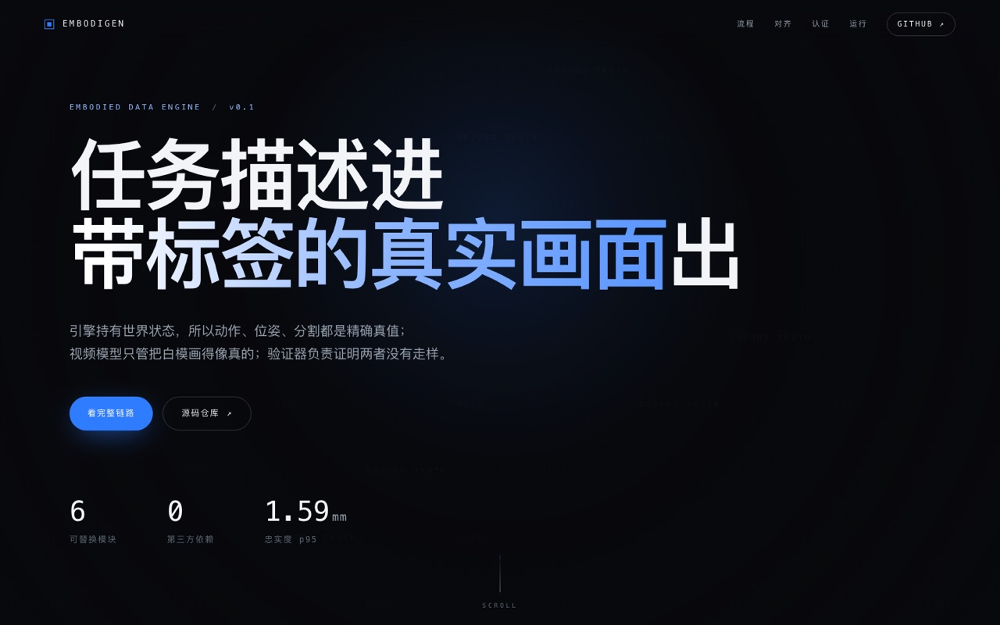
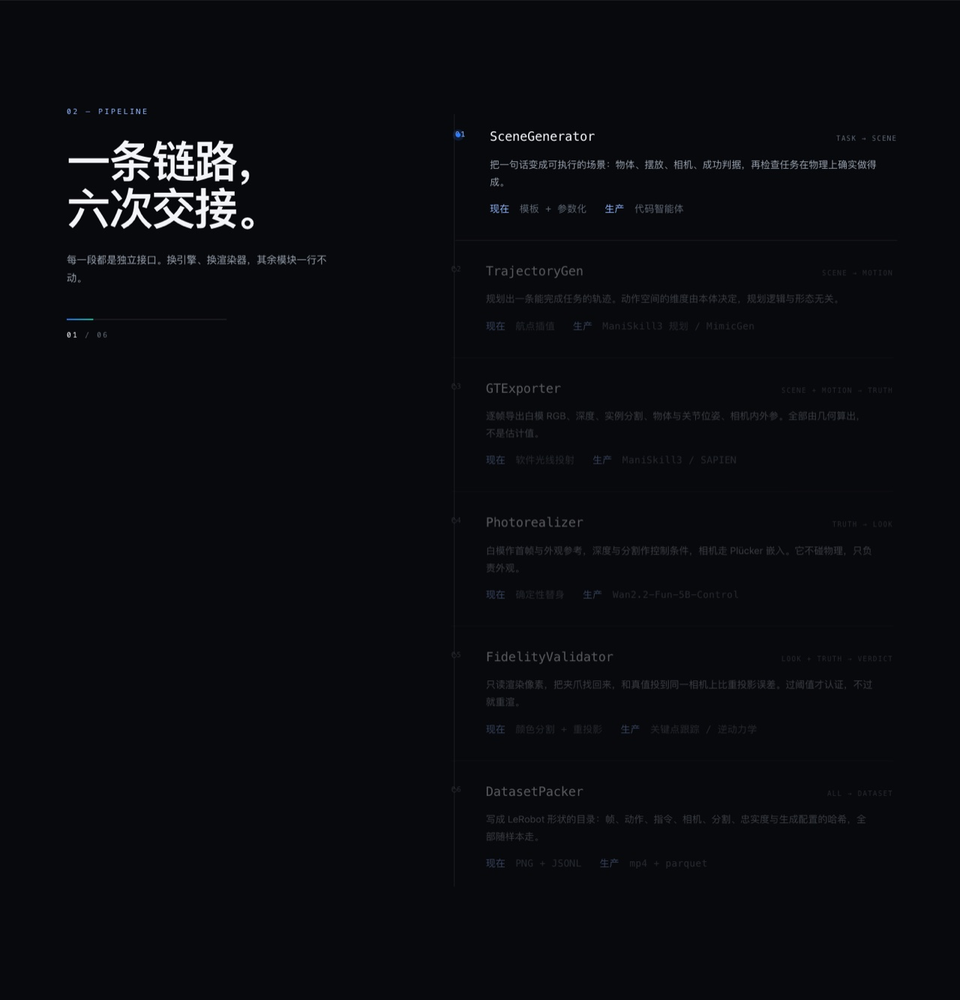
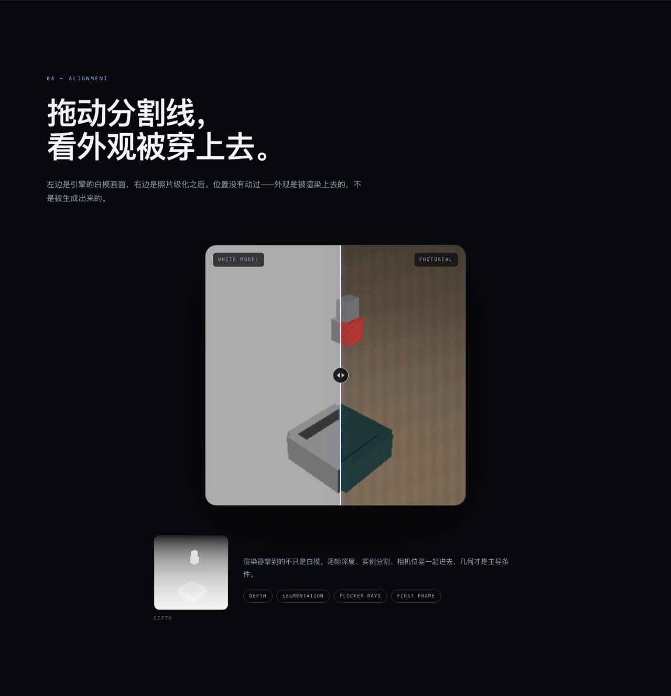
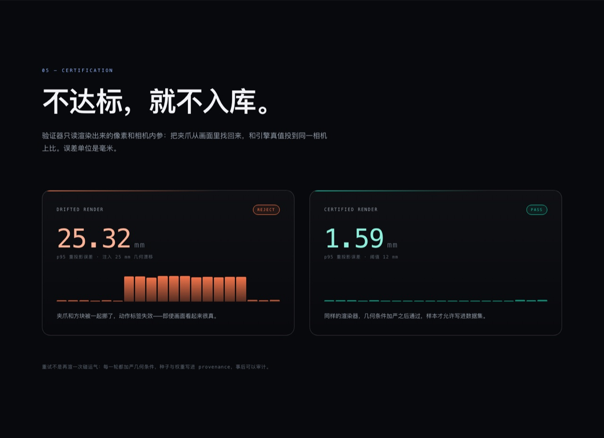

# EmbodiGen

**任务描述进，带精确动作标签的照片级数据集出。**

具身数据引擎的参考实现：仿真引擎负责持有世界状态、导出精确真值；视频生成模型只负责把白模画面渲染成真实外观；中间用验证器确认渲染之后动作标签依然成立。

[](docs/index.html)

```
一句话任务 → 场景 → 轨迹 → 精确真值 → 照片级化 → 忠实度认证 → 数据集
```

## 当前状态

全链路已经跑通，六个模块都有稳定接口，**引擎和渲染器是参考实现（mock）**。这不是掩饰：这套代码现在的价值是接口和数据契约已经定死，验证器已经能真实地抓出渲染漂移，接真模型的成本被压到"实现一个方法"。

| 模块 | 现在 | 生产替换 |
|---|---|---|
| `SceneGenerator` | 模板 + 参数化 + 可达性检查 | 代码智能体自动布场景 |
| `TrajectoryGen` | 航点插值 + 平滑 | ManiSkill3 规划 / MimicGen 倍增 |
| `GTExporter` | 软件光线投射，几何真值 | ManiSkill3 (SAPIEN/PhysX) |
| `Photorealizer` | 材质 + 光照 + 颗粒的确定性替身 | Wan2.2-Fun-5B-Control 微调 |
| `FidelityValidator` | 颜色分割 + 重投影误差 | 关键点/位姿跟踪、逆动力学模型 |
| `DatasetPacker` | LeRobot 形状的目录 + JSONL | 加 mp4 / parquet 编码 |

核心是零依赖：**只用到 Python 标准库**，clone 下来就能跑，不需要 GPU、不需要 numpy。重后端通过 extras 挂进来，见 `pyproject.toml`。

## 快速开始

```bash
git clone git@github.com:wellkilo/embodigen.git
cd embodigen
python3 -m venv .venv && source .venv/bin/activate   # 可选
pip install -e .

# 一句话 → 一条带认证的样本（96x96，约 3 秒）
embodigen gen --task "把红色方块放进盒子" --out out --resolution 96

# 从磁盘上的产物重新验一遍（不需要重跑引擎）
embodigen validate --episode out/episodes/franka-0000

# 三种形态跑同一套框架
embodigen gen --task "把蓝色方块放进盒子" --robot mobile  --out out
embodigen gen --task "把绿色方块放进盒子" --robot humanoid --out out

# 看有哪些可替换后端
embodigen backends

# 跑测试（12 个，不到 1 秒）
python3 -m unittest discover -s tests
```

没有装成包时，用 `PYTHONPATH=src python3 -m embodigen.cli gen ...` 等价。

## 展示页

[`docs/index.html`](docs/index.html) 是一个零构建的单页展示：滚动驱动的六段流程、白模与照片级的拖动对比、以及直接来自管线运行的真实指标。直接双击打开即可，或者：

```bash
python3 -m http.server 8000 -d docs
```

页面上的每个数字都来自 `scripts/build_docs_assets.py` 的一次真实运行——帧序列、对照图、误差曲线全部由它生成，页面不会和代码脱节：

```bash
python3 scripts/build_docs_assets.py --out docs/assets
```

六段流程（截图为 `docs/index.html` 的实际渲染）：

[](docs/index.html)

拖动分割线对比白模与照片级：

[](docs/index.html)

忠实度认证：注入漂移的那一版被拒绝，加严几何条件后通过：

[](docs/index.html)

## 它到底保证了什么

一条 episode 里，**真值由引擎给，真实感由渲染器给，两者是否还对得上由验证器给**。三件事在数据结构上是分开的：

```python
gt: list[FrameGT]        # 白模 RGB / 深度 / 实例分割 / 关节与物体位姿 / 相机内外参 / 动作
photoreal: PhotorealResult   # 渲染出的真实感视频帧
fidelity: FidelityReport     # 重投影误差、p95/max、过/不过、逐帧误差
```

`FrameGT.depth` 和 `FrameGT.seg` 是从几何直接算出来的，不是估计值。这就是"标签精确"的全部来源。

## 验证器在测什么

它只读渲染出来的像素和相机内参，把夹爪从画面里恢复出来，再把引擎真值的夹爪位置用同一个相机投到像素上，两者之间的像素距离按深度换算成毫米。

为什么不直接反投 3D？因为用轮廓质心配合表面深度反投，拿到的是**可见表面**，不是物体中心——4cm 的方块会凭空多出 2–3cm 的偏差，把测量本身变成噪声。重投影是同类比同类："夹爪有没有被渲染到引擎放它的地方"，而这恰好就是照片级化在接触点附近最容易破坏的性质。

闸门用末端误差：它是真正驱动动作的标签，而且在方块被夹爪挡住时仍然可追踪。物体侧误差作为参考值一并报告。

实测（franka，`--threshold 12`）：

| 条件 | p95 误差 | 判定 |
|---|---|---|
| 正常渲染，64px | 2.9 mm | 通过 |
| 正常渲染，96px | 2.3 mm | 通过 |
| 正常渲染，224px | 1.6 mm | 通过 |
| 注入 25 mm 几何漂移，64px | 27.4 mm | 拒绝 |
| 注入 25 mm 几何漂移，96px | 28.1 mm | 拒绝 |
| 注入 25 mm 几何漂移，224px | 25.3 mm | 拒绝 |

漂移按毫米注入，所以同一个数字在 64px 和 224px 下含义相同。默认第一轮会注入 25 mm 漂移来演示失败路径：验证器拒绝 → 加严几何条件重渲 → 通过。产物里会记录 `attempts`、`seeds` 和每一轮的 `condition_weights`，可以事后审计。

## 产物结构

```
out/episodes/franka-0000/
├── meta/
│   ├── info.json          # LeRobot 风格的特征描述
│   ├── provenance.json    # 引擎、渲染器、配置哈希、种子、尝试次数
│   ├── fidelity.json      # 逐帧误差与判定
│   └── scene.json         # 相机、物体、成功判据
├── data/chunk-000/
│   └── episode_000000.jsonl   # 动作 / 状态 / 指令 / 漂移标记
└── frames/
    ├── photoreal/  000.png 000.rgb
    ├── white/      000.png 000.rgb
    ├── depth/      000.f32      # float32 原始深度，平面 Z
    └── seg/        000.u16      # 实例分割
```

同时存 PNG 和原始 buffer，是为了让"给人看"和"给程序读"都不用解码。整个目录自包含：`embodigen validate` 只凭它就能重算忠实度。

## 接真实后端

六个接口在 `src/embodigen/modules/base.py`，都是结构化协议，不需要继承：

```python
class GTExporter(Protocol):
    name: str
    def export(self, scene: SceneSpec, trajectory: Trajectory) -> list[FrameGT]: ...

class Photorealizer(Protocol):
    name: str
    def render(self, gt: list[FrameGT], scene: SceneSpec,
               condition_weights: dict[str, float], seed: int) -> PhotorealResult: ...
```

接 ManiSkill3 只需要实现 `export`：把 SAPIEN 的 RGB、深度、分割和状态向量填进 `FrameGT`。接 Wan 只需要实现 `render`：白模 RGB 作首帧与外观参考，深度/分割走控制适配器，相机位姿用 `CameraModel.plucker()` 给出的逐像素 Plücker 嵌入。接完之后在 `BACKENDS` 里注册名字，其余五个模块一行不用改。

## 已知边界

这些是刻意留下的，不是没想到：

- **渲染器不是照片级的**。它是确定性替身，用来跑通数据通路和闭环，不产生"看起来像真机"的画面。
- **验证器靠颜色分割**。真实实现要换关键点/位姿跟踪或逆动力学模型，否则一换材质就得改参考色。接口和判定逻辑不用变。
- **只有一个场景模板**（桌面抓取放置）。场景多样性靠参数采样，不靠自由生成。
- **移动/人形只验证了接口和动作空间**，没有底盘动力学和人形平衡，轨迹仍是末端空间插值。
- **没有 mp4/parquet 编码**。装 `[lerobot]` extra 后会自动额外写 parquet；视频编码待接 ffmpeg。
- **关节角是占位解算**，真正的 IK 属于引擎后端。

## 路线图

1. 接 ManiSkill3 的 `GTExporter`，用真引擎跑同一批任务，对比标签一致性。
2. 接 Wan2.2-Fun-5B-Control，先用单场景小样本过拟合，跑通"白模 → 真实外观"。
3. 验证器换成关键点跟踪，建立"渲染参数 vs 忠实度误差"的曲线，用来定条件权重。
4. 轨迹倍增（MimicGen）与场景多样性（代码智能体），把单条样本变成数据集。
5. 用生成数据训小策略，和纯仿真数据比成功率——这是这套东西值不值得继续投的判据。

## 许可

私有仓库，许可待定。
