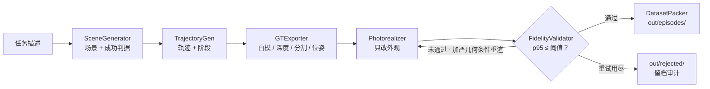

<p align="center">
  <a href="https://wellkilo.github.io/embodigen/">
    
  </a>
  <br />
  <sub>▶ <a href="https://wellkilo.github.io/embodigen/assets/showcase.mp4">观看 68 秒完整演示视频（MP4）</a> · 页面上的每个数字和每一帧都来自管线的真实运行</sub>
</p>

<h1 align="center">EmbodiGen</h1>

<p align="center">
  <b>一句任务描述，换一批带精确动作标签的真实感训练数据。</b><br />
  <sub>引擎负责真值 · 渲染器负责外观 · 验证器证明两者没有走样</sub>
</p>

<p align="center">
  <a href="https://github.com/wellkilo/embodigen/actions/workflows/ci.yml"></a>
  
  
  
  
  <a href="https://wellkilo.github.io/embodigen/"></a>
</p>

<p align="center">
  <a href="https://wellkilo.github.io/embodigen/"><b>在线展示</b></a> ·
  <a href="#快速开始">快速开始</a> ·
  <a href="#它是什么">原理</a> ·
  <a href="#输出长什么样">数据格式</a> ·
  <a href="#替换后端">替换后端</a>
</p>

---

## 快速开始

```bash
git clone https://github.com/wellkilo/embodigen && cd embodigen
python3 -m venv .venv && . .venv/bin/activate
pip install -e .

# 一条
embodigen gen --task "把红色方块放进盒子" --out out --resolution 96
embodigen validate --episode out/episodes/franka-0000

# 一批（8 条，4 进程）
embodigen gen --task "把红色方块放进盒子" --out out --resolution 64 --episodes 8 --workers 4
embodigen index --out out

# 看一眼
embodigen preview --episode out/episodes/franka-0000
```

零第三方依赖，Python ≥ 3.11，不需要 GPU。单条 96 px 约 3 秒，8 条 64 px 用 4 进程约 3.5 秒（Apple Silicon 实测）。

<details>
<summary><b>真实输出</b></summary>

```
$ embodigen gen --task "把红色方块放进盒子" --out out --resolution 96
episode      franka-0000
instruction  把红色方块放进盒子
robot        arm / franka
frames       28 @ 8 fps, 96x96
attempts     2 (seeds [0, 1])
fidelity     p95     2.27 mm  max     2.28 mm  threshold 12 mm  -> PASS
written      out/episodes/franka-0000
```

`attempts 2`：第一次渲染被默认注入 25 mm 几何漂移（`--drift`，用来演示闭环），验证器拒绝，第二次加严几何条件后通过。用 `--drift 0` 可关闭注入。

</details>

## 它是什么

机器人策略训练缺的不是视频，是**带准确动作标签**的视频。纯仿真的标签准，但画面是 CG；生成模型的画面真，但动作只能靠估计。

EmbodiGen 把这两件事拆开：

| | |
|---|---|
| **输入** | 一句任务，例如「把红色方块放进盒子」；外加机器人本体配置（URDF + 动作空间） |
| **输出** | 自包含的 episode 目录：照片级帧 + 动作序列 + 阶段标签 + 精确的深度 / 分割 / 位姿 + 忠实度报告 |
| **保证** | 标签由引擎从几何算出，不是从视频里估的；渲染器只改外观；验证器证明几何没有被带偏，**不达标的样本进不了数据集** |



六个阶段都在 `src/embodigen/modules/` 下，各自一个接口。当前的场景、引擎和渲染器是参考实现；换成 ManiSkill3 或 Wan 只需实现对应方法并注册。产物按 LeRobot 的形状组织，可以直接接进 OpenVLA、π0、Diffusion Policy 这类训练流程：视频帧喂视觉塔，`action` 喂动作头，`phase` 做子任务监督，`fidelity` 用来筛选或加权样本。

## 输出长什么样

<p align="center">
  <br />
  <sub>同一条 episode 的四个通道：白模 · 照片级 · 深度 · 实例分割（<code>embodigen preview</code> 的真实输出）</sub>
</p>

```
out/
├── index.json                  # 数据集账本：每条的 p95 / 重试次数 / 判定 + 良率汇总
├── episodes/                   # 只放认证通过的样本
│   └── franka-0000/
│       ├── meta/
│       │   ├── info.json        # 特征描述（LeRobot 形状）
│       │   ├── provenance.json  # 引擎 · 渲染器 · 验证器 · 配置哈希 · 种子 · 重试
│       │   ├── fidelity.json    # 逐帧误差与判定
│       │   └── scene.json       # 相机 · 物体 · 成功判据
│       ├── data/chunk-000/
│       │   └── episode_000000.jsonl   # 一帧一行，共 28 行
│       └── frames/
│           ├── photoreal/  002.png / .rgb   # 渲染后的真实感帧
│           ├── white/      002.png / .rgb   # 引擎白模
│           ├── depth/      002.f32          # float32，平面 Z（米）
│           └── seg/        002.u16          # 实例分割 id
└── rejected/                   # 重试用尽仍未通过的样本，结构相同，留档审计
```

`episode_000000.jsonl` 里的一行（真实产物，未做修饰）：

```json
{
  "frame_index": 2,
  "timestamp": 0.375,
  "language_instruction": "把红色方块放进盒子",
  "phase": "pre_grasp",
  "frames": {
    "photoreal": "frames/photoreal/002.png",
    "white_model": "frames/white/002.png",
    "depth": "frames/depth/002.f32",
    "segmentation": "frames/seg/002.u16"
  },
  "action": [-0.494248, 1.008909, -0.8, 0.0, 0.0, 0.0, 0.04],
  "observation": {
    "eef_position": [-0.041781, 0.126114, 0.14],
    "gripper_width": 0.04,
    "object_positions": { "cube": [-0.041781, 0.126114, 0.02] }
  },
  "fidelity": { "drift_px": 0.0 }
}
```

| 字段 | 含义 |
|---|---|
| `action` | 7 维控制量：三轴平移速度（m/s）、三轴角速度（当前版本为 0）、夹爪开度（m） |
| `phase` | 规划器给出的子任务标签：`pre_grasp` → `grasp` → `close` → `lift` → `transport` → `place` → `release` → `retreat` |
| `observation` | 引擎真值：末端位置、夹爪开度、物体中心 |
| `frames` | 同一帧的四个通道，路径相对于 episode 根目录 |
| `fidelity.drift_px` | 该帧被注入的几何漂移；认证过的样本为 0 |

`meta/fidelity.json` 是这条样本的判定（另有 `per_frame_mm`，28 个逐帧误差）：

| 字段 | 值 |
|---|---|
| `passed` | `true` |
| `threshold_mm` | `12.0` |
| `p95_error_mm` | `2.265503286773332` |
| `max_error_mm` | `2.278999569164691` |
| `mean_error_mm` | `1.0253204858279945` |
| `validator` | `keypoint-appearance-v0` |
| `notes` | `object mean 3.3 mm …` / `eef mean 1.0 mm, gate on eef p95` |

读一条样本，不需要 import 本项目：

```python
import json
from pathlib import Path

root = Path("out/episodes/franka-0000")
rows = [json.loads(l) for l in (root / "data/chunk-000/episode_000000.jsonl").open()]

row = rows[10]
action = row["action"]                       # 7 维，直接喂策略
phase = row["phase"]                         # 子任务标签
image = root / row["frames"]["photoreal"]    # 照片级帧
depth = root / row["frames"]["depth"]        # float32 深度，96×96
```

## 验证器在测什么

<p align="center">
  
</p>

它只读渲染出来的像素和相机内参：把夹爪从画面里找回来，与引擎真值投到同一相机上比重投影误差，换算成毫米。

| 条件（96 px） | p95 | 判定 |
|---|---|---|
| 正常渲染 | 2.27 mm | 通过（阈值 12 mm） |
| 注入 25 mm 几何漂移，不重试 | 28.10 mm | 拒绝 → `out/rejected/` |

重试不是再渲一次碰运气：每一轮都加严几何、深度、分割的条件权重，种子与权重写进 `meta/provenance.json`，事后可审计。

## 批量与账本

<p align="center">
  
</p>

`--episodes N` 在种子 `seed … seed+N-1` 上生成 N 条，`--workers K` 用多进程并行；每条独立验证，认证通过的进 `out/episodes/`，没通过的进 `out/rejected/`。所有结果合并进 `out/index.json`：

```bash
embodigen gen --task "把红色方块放进盒子" --out out --resolution 64 --episodes 8 --workers 4
embodigen index --out out      # 打印每条的 p95、重试次数、判定，以及良率
```

多次运行会按 episode id 合并进同一本账，不会互相覆盖。

## 命令一览

| 命令 | 作用 |
|---|---|
| `embodigen gen --task "..." [--robot franka\|mobile\|humanoid]` | 跑完整链路，生成一条 episode |
| `embodigen gen ... --episodes N --workers K` | 在种子 `seed … seed+N-1` 上并行生成一批 |
| `embodigen validate --episode <dir>` | 只凭目录重算忠实度 |
| `embodigen preview --episode <dir> [--channels white,photoreal,depth,seg]` | 写出四通道 GIF |
| `embodigen index --out <dir>` | 打印数据集账本与良率 |
| `embodigen backends` | 列出已注册的后端与机器人本体 |

常用参数：`--resolution`（默认 64）、`--fps`（8）、`--threshold`（12 mm）、`--attempts`（3）、`--drift`（首轮注入漂移，默认 25 mm，0 关闭）、`--seed`。

## 替换后端

每个阶段只是一个满足 `src/embodigen/modules/base.py` 协议的对象（按形状匹配，不需要继承）。接一个新渲染器：

```python
# my_pkg/wan.py
class WanPhotorealizer:
    name = "wan2.2-fun-5b-control"

    def __init__(self, drift_mm=0.0, drift_frames=(0, 0), grain=1.0): ...

    def render(self, gt, scene, condition_weights, seed):
        # 白模作首帧，深度 + 分割作控制，相机走 Plücker 嵌入
        ...
        return PhotorealResult(model=self.name, seed=seed, frames=frames)
```

然后在 `BACKENDS["photoreal"]` 里注册 `"wan": "my_pkg.wan:WanPhotorealizer"`，`PipelineConfig(photoreal_backend="wan")` 即可，其余阶段一行不动。新机器人本体则只需在 `configs/robots/` 放一个 `<name>.toml`，`embodigen backends` 会自动列出。

## 让 agent 替你装

把下面这段直接粘给 Codex 或 Claude Code：

> 克隆 `https://github.com/wellkilo/embodigen` 到本地，用 `python3 -m venv .venv` 建环境并激活，执行 `pip install -e .`。
> 然后运行 `embodigen gen --task "把红色方块放进盒子" --out out --resolution 96`，
> 读取 `out/episodes/franka-0000/meta/fidelity.json`，告诉我 p95 误差、阈值和是否通过，
> 并数一下 `frames/photoreal/` 里有多少帧。
> 任何一步失败，读完整报错再修，不要跳过。

仓库根目录的 [AGENTS.md](AGENTS.md) 写了安装、验收标准和常用命令，agent 会自动读到。

## 开发

```bash
make test       # 21 个单元测试
make demo       # 单条生成 + 验证
make batch      # 8 条批量 + 账本
make docs       # 从真实运行重建展示页素材（约 75 秒）
```

展示页在 `docs/`，纯静态、无构建步骤，直接用浏览器打开 `docs/index.html` 即可。三维回放（`docs/assets/live.js`）是一个约 600 行的 Canvas2D 渲染器，读取的是 `build_docs_assets.py` 从真实 episode 导出的数据。

## 边界

- **渲染器是 mock**：它证明数据通路和闭环，不产生照片级画面。
- **验证器靠颜色分割**：换材质要改参考色，真实实现应换成关键点跟踪；它还借用了真值深度来排除背景像素。
- **只有一个抓放模板**：移动与人形只验证了接口和动作空间。
- **许可证待定**：`pyproject.toml` 里是 `TBD`，正式开源前需要补上 LICENSE。
