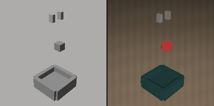

<p align="center">
  
</p>

<h1 align="center">EmbodiGen</h1>

<p align="center">
  <b>一句任务描述，换一批带精确动作标签的真实感训练数据。</b>
</p>

<p align="center">
  <a href="https://github.com/wellkilo/embodigen/actions/workflows/ci.yml"></a>
  
  
  
  <a href="https://wellkilo.github.io/embodigen/"></a>
</p>

---

## 它是什么

机器人策略训练缺的不是视频，是**带准确动作标签**的视频。纯仿真的标签准但画面是 CG，生成模型的画面真但动作只能靠估计。

EmbodiGen 把这两件事拆开：引擎负责真值，渲染器负责外观，验证器负责证明两者没有走样。

<table>
  <tr>
    <td width="84"><b>输入</b></td>
    <td>一句任务，例如「把红色方块放进盒子」；外加机器人本体配置（URDF + 动作空间）</td>
  </tr>
  <tr>
    <td><b>输出</b></td>
    <td>一个自包含的 episode 目录：照片级帧 + 动作序列 + 精确的深度 / 分割 / 位姿 + 忠实度报告</td>
  </tr>
  <tr>
    <td><b>保证</b></td>
    <td>标签由引擎从几何算出，不是从视频里估的；渲染器只改外观；验证器证明几何没有被带偏</td>
  </tr>
</table>

六个阶段（场景 / 轨迹 / 真值导出 / 照片级化 / 验证 / 打包）都在 `src/embodigen/modules/` 下，各自一个接口。当前场景生成、引擎和渲染器是参考实现，换成 ManiSkill3 或 Wan 只需要实现对应的方法。

产物按 LeRobot 的形状组织，可以直接读进 OpenVLA、π0、Diffusion Policy 这类训练流程：视频帧喂视觉塔，`action` 喂动作头，`fidelity` 用来做样本筛选或加权。

## 输出长什么样

```
out/episodes/franka-0000/
├── meta/
│   ├── info.json        # 特征描述（LeRobot 形状）
│   ├── provenance.json  # 引擎 · 渲染器 · 配置哈希 · 种子 · 重试次数
│   ├── fidelity.json    # 逐帧误差与判定
│   └── scene.json       # 相机 · 物体 · 成功判据
├── data/chunk-000/
│   └── episode_000000.jsonl    # 一帧一行，共 28 行
└── frames/
    ├── photoreal/   002.png    # 渲染后的真实感帧
    ├── white/       002.png    # 引擎白模
    ├── depth/       002.f32    # float32，平面 Z（米）
    └── seg/         002.u16    # 实例分割 id
```

`episode_000000.jsonl` 里的一行，就是下面这样（真实产物，未做任何修饰）：

```json
{
  "frame_index": 2,
  "timestamp": 0.375,
  "language_instruction": "把红色方块放进盒子",
  "frames": {
    "photoreal": "frames/photoreal/002.png",
    "white_model": "frames/white/002.png",
    "depth": "frames/depth/002.f32",
    "segmentation": "frames/seg/002.u16"
  },
  "action": [-0.494248, 1.008909, -0.8, 0.0, 0.0, 0.0, 0.04],
  "observation": {
    "eef_position": [-0.041781, 0.126114, 0.14],
    "gripper_width": 0.04,
    "object_positions": { "cube": [-0.041781, 0.126114, 0.02] }
  },
  "fidelity": { "drift_px": 0.0 }
}
```

字段说明：

| 字段 | 含义 |
|---|---|
| `action` | 7 维控制量：三轴平移速度（m/s）、三轴角速度（当前版本为 0）、夹爪开度（m） |
| `observation` | 引擎真值：末端位姿、夹爪开度、物体中心 |
| `frames` | 同一帧的四个通道，路径相对于 episode 根目录 |
| `fidelity.drift_px` | 该帧被注入的几何漂移；认证过的样本为 0 |

`meta/fidelity.json` 是这条样本的判定结果（另有 `per_frame_mm`，28 个逐帧误差）：

| 字段 | 值 |
|---|---|
| `passed` | `true` |
| `threshold_mm` | `12.0` |
| `p95_error_mm` | `2.265503286773332` |
| `max_error_mm` | `2.278999569164691` |
| `mean_error_mm` | `1.0253204858279945` |
| `notes` | `object mean 3.3 mm …` / `eef mean 1.0 mm, gate on eef p95` |

读一条样本：

```python
import json
from pathlib import Path

root = Path("out/episodes/franka-0000")
rows = [json.loads(l) for l in (root / "data/chunk-000/episode_000000.jsonl").open()]

row = rows[10]
action = row["action"]                       # 7 维，直接喂策略
image = root / row["frames"]["photoreal"]    # 照片级帧
depth = root / row["frames"]["depth"]        # float32 深度，96×96
```

## 跑起来

```bash
pip install -e .
embodigen gen --task "把红色方块放进盒子" --out out --resolution 96
embodigen validate --episode out/episodes/franka-0000
```

零第三方依赖，Python ≥ 3.11，clone 下来就能跑，不需要 GPU。

## 让 agent 替你装

把下面这段直接粘给 Codex 或 Claude Code：

> 克隆 `https://github.com/wellkilo/embodigen` 到本地，用 `python3 -m venv .venv` 建环境并激活，执行 `pip install -e .`。
> 然后运行 `embodigen gen --task "把红色方块放进盒子" --out out --resolution 96`，
> 读取 `out/episodes/franka-0000/meta/fidelity.json`，告诉我 p95 误差、阈值和是否通过，
> 并数一下 `frames/photoreal/` 里有多少帧。
> 任何一步失败，读完整报错再修，不要跳过。

仓库根目录的 [AGENTS.md](AGENTS.md) 写了安装、验收标准和常用命令，agent 会自动读到。

## 验证器在测什么

它只读渲染出来的像素和相机内参：把夹爪从画面里找回来，与引擎真值投到同一相机上比重投影误差。

| 条件 | p95 | 判定 |
|---|---|---|
| 正常渲染，96px | 2.3 mm | 通过（阈值 12 mm） |
| 注入 25 mm 几何漂移 | 28.1 mm | 拒绝，加严条件重渲 |

不达标不入库；每次重试的种子与条件权重都记在 `meta/provenance.json`，事后可审计。

## 边界

- **渲染器是 mock**：它证明数据通路和闭环，不产生照片级画面。
- **验证器靠颜色分割**：换材质要改参考色，真实实现应换成关键点跟踪。
- **只有一个抓放模板**：移动与人形只验证了接口和动作空间。

这些都能替换，接口在 `src/embodigen/modules/base.py`。

<p align="center">
  <sub>
    <a href="docs/index.html">展示页</a> ·
    <a href="https://wellkilo.github.io/embodigen/">在线预览</a> ·
    <code>python3 -m unittest discover -s tests</code>
  </sub>
</p>
